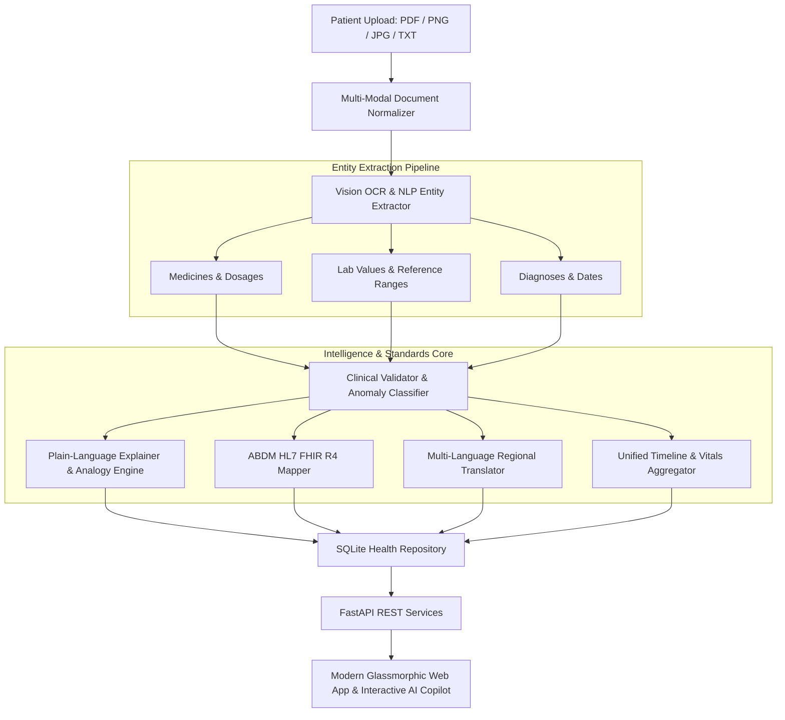

# Nirogya AI (निरोग्य) — Personal Health Copilot
### Future of Personalized Healthcare with AI | Hackathon Project Submission

> **Challenge:** Design and develop an AI-powered Personal Health Copilot that helps individuals understand, organize, and manage their healthcare journey through intelligent analysis of medical records, prescriptions, diagnostic reports, and wellness data.

---

## 🌟 Key Features & Problem Statement Alignment

| Problem Statement Requirement | Nirogya AI Implementation |
|---|---|
| **1. Medical Record Intelligence & OCR** | Multi-modal ingestion of prescriptions, lab panels, discharge notes, and mobile photos. Extracts medicines, dosages, frequencies (1-0-1, OD, BD), LOINC-coded lab values, reference intervals, abnormal flags, and doctor details. |
| **2. Plain-Language AI Health Summary** | Translates complex clinical values into 8th-grade level empathetic explanations. Explains abnormal values (e.g. HbA1c 8.8%, Creatinine 1.35) with intuitive real-world analogies, actionable lifestyle modifications, and questions to ask the doctor. |
| **3. Longitudinal Biomarker Velocity & Deltas (WOW Factor)** | Cross-document intelligence comparing current tests against historical baselines (e.g., HbA1c ▲ +18.9% worsening, Creatinine ▲ +22.7% creeping up) with directional trajectory badges. |
| **4. Pharmacological Drug Safety Matrix (WOW Factor)** | Real-time clinical drug-drug and drug-food interaction inspector: Metformin + Glimepiride hypoglycemia vigilance, Metformin + Telmisartan cardio-renal synergy, and strict NSAID painkiller contraindication for elevated creatinine. |
| **5. Voice-Enabled Regional Copilot (WOW Factor)** | Web Speech API integration: patients can click the microphone to speak questions in English or Hindi, and click the speaker icon to listen to spoken AI health explanations! |
| **6. ABDM Consent Manager Simulator (WOW Factor)** | 3-step interactive simulation of India's ABDM Milestone 2 consent-driven data exchange: Hospital request ➔ Patient OTP approval ➔ Decrypted FHIR R4 transfer. |
| **7. 1-Click Printable Pocket Health Card (WOW Factor)** | Printable emergency health card with ABHA QR code, active meds timetable, and clinical alerts formatted for WhatsApp sharing and OPD visits. |
| **8. Multi-Language Support (Bonus)** | Real-time multi-language interface and clinical summaries in **6 Indian languages**: English, Hindi (हिन्दी), Telugu (తెలుగు), Tamil (தமிழ்), Bengali (বাংলা), and Marathi (मराठी). |
| **9. ABDM / ABHA Readiness (Bonus)** | Standardized data model aligned to India's **Ayushman Bharat Digital Mission (ABDM)**. Generates and links 14-digit ABHA ID (`14-8921-4350-9812`), creates and exports **HL7 FHIR R4 Document Bundles**. |

---

## 🏗️ System Architecture & Data Pipeline



### ABDM / FHIR R4 Standards Schema
- **Patient**: ABHA ID identifier, demographic attributes, NRCeS R4 profile.
- **Observation**: LOINC standard coding (e.g., `4548-4` for HbA1c, `1558-6` for Fasting Glucose, `2160-0` for Creatinine), numeric `valueQuantity`, interpretation flag (`H`, `L`, `N`), reference ranges.
- **MedicationRequest**: Brand and generic names, dosage instructions, frequency timing, route.
- **Condition**: SNOMED CT coded clinical diagnoses.
- **DiagnosticReport**: Encapsulates clinical impressions and observation references.
- **Bundle**: HL7 FHIR R4 Document Bundle ready for Indian Health Locker export.

---

## 🚀 Quick Start & How to Run Locally

### Prerequisites
- Python 3.10+ (managed via `uv` or standard Python)

### 1. Launch the Server
In the project root directory:
```powershell
uv run python start_server.py
```
*Or using the local virtual environment:*
```powershell
.\.venv\Scripts\python.exe start_server.py
```

### 2. Open in Browser
Open your browser at:
- **Web Application:** `http://localhost:8000`
- **Swagger Interactive API Docs:** `http://localhost:8000/docs`

---

## 🧪 Hackathon Demo Walkthrough (For Judges)

1. **Test Preloaded Clinical Records**:
   - Click **"Metabolic & Lipid Panel"** to inspect a high-risk diabetic lab panel with HbA1c 8.8%, fasting glucose 186 mg/dL, and elevated creatinine.
   - Click **"Cardio-Diabetic Rx"** to inspect an outpatient prescription with Glycomet-GP 2, Telma 40, and Rosuvas 10.
   - Click **"Hospital Discharge"** to review a resolved bronchopneumonia inpatient course and post-discharge step-down therapy.
2. **Evaluate Plain-Language AI Explanations**:
   - See the **Executive Health Understanding** banner.
   - Examine the abnormal biomarker cards: notice the real-world analogies, actionable lifestyle modifications, and curated questions for the doctor.
3. **Switch Regional Languages**:
   - Use the language selector in the top right to switch to **हिन्दी (Hindi)**, **తెలుగు (Telugu)**, or **தமிழ் (Tamil)**.
   - Notice how the UI and clinical summary instantly render in the regional language.
4. **Inspect ABDM & FHIR R4 Standards**:
   - Switch to the **ABDM & FHIR R4** tab.
   - Review the digital government-style ABHA Health Card.
   - View the live HL7 FHIR R4 JSON bundle and click **"Download FHIR Bundle"**.
5. **Chat with AI Health Copilot**:
   - Click the bottom-right **"✨ AI Health Copilot"** button.
   - Click suggested chips like *"Explain my high HbA1c"* or *"Are my blood pressure medicines safe with metformin?"*.

---

## 🛡️ Clinical Safety & Ethics Notice
Nirogya AI is built with responsible healthcare AI guidelines:
- Strict medical disclaimer banners and footnotes.
- Prominent emergency red flag symptoms notice for cardiovascular or respiratory emergencies.
- No hallucinated speculative diagnoses; all reasoning is strictly grounded in the ingested clinical records.
